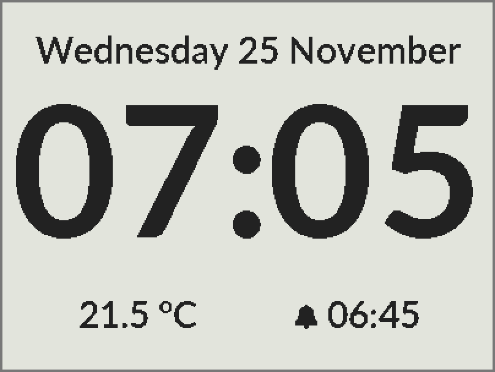
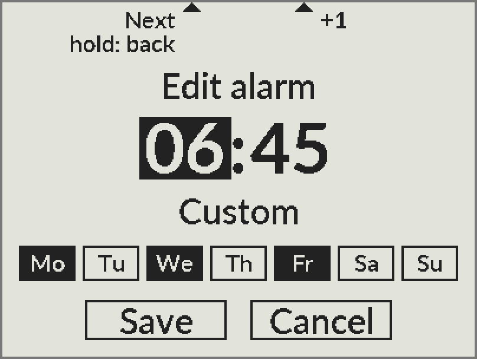
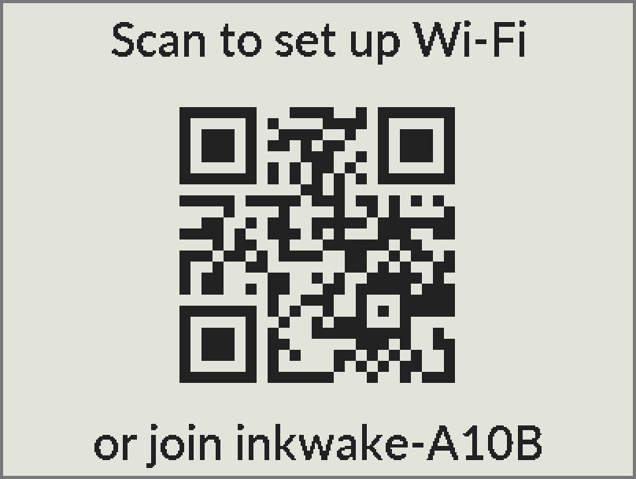

# inkwake

Open source battery alarm clock on the Waveshare ESP32-S3-RLCD-4.2: a 4.2" reflective LCD that
needs no backlight, deep sleep between minutes, so it runs for weeks on one 18650 and is plugged in
only to charge. Alarms work with Wi-Fi down.

<p align="center">
  
</p>

<p align="center">
  
  
  
</p>

<sub>Screens rendered on a PC from the firmware's own drawing code (`firmware/tools/preview_face.cpp`).</sub>

## What it does

Works today (alpha, see [releases](https://github.com/braveadmin/inkwake/releases)):

- Clock face with date, room temperature (on-board SHTC3) and the next alarm, updated each minute
  with a partial refresh; the board sleeps in between.
- Time from the on-board RTC, corrected over NTP once a day, with the crystal's drift trimmed
  automatically; POSIX timezones with DST.
- Up to 16 alarms with weekdays and labels, beep through the built-in speaker, snooze 9 min, stop
  by holding the KEY button, skip the next ring with BOOT. Missed or skipped hours around DST are
  handled (ADR-0017).
- Everything set with the two buttons: date & time, timezone, alarms, Wi-Fi. No phone or Wi-Fi
  needed.
- Optional Wi-Fi setup from a phone: the clock shows a QR code, you join its setup network and pick
  your Wi-Fi on a captive page. Up to five networks remembered.
- Low-battery mark on the face; NTP and Wi-Fi skipped when the battery is critical.

Planned for v1.0: touch snooze through the case, ambient wake sounds, sunrise light, web UI and OTA
updates, widgets (weather first), a 3D-printed case. Hobby pace, no dates:
[docs/roadmap.md](docs/roadmap.md), scope in [docs/features.md](docs/features.md), decisions in
[docs/adr/](docs/adr/).

Technically interesting bits: the ST7305 reflective panel keeps its image through deep sleep, is
redrawn only where it changed, and needed its power-mode timing fixed to stop it freezing on battery
([#25](https://github.com/braveadmin/inkwake/issues/25)).

## Try it

You need only the [Waveshare ESP32-S3-RLCD-4.2](https://docs.waveshare.com/ESP32-S3-RLCD-4.2) with an 18650 cell,
a USB-C cable and Chrome or Edge. No toolchain.

1. Download the three `.bin` files from the [latest release](https://github.com/braveadmin/inkwake/releases/latest).
2. Connect the board by USB, open https://adafruit.github.io/Adafruit_WebSerial_ESPTool/ and click
   Connect.
3. First install: click Erase, then program these files:

   | Address | File |
   | --- | --- |
   | 0x0 | `...-bootloader.bin` |
   | 0x8000 | `...-partitions.bin` |
   | 0x10000 | the firmware, `inkwake-vX.Y.Z.bin` |

4. Unplug the USB cable and plug it back in. The clock asks for the timezone, date and time, set
   with the two buttons on the top edge (the screen labels them).
5. Optional: hold KEY 5 s for the Wi-Fi setup and scan the QR code with a phone; the clock then
   keeps its time with NTP. Later, hold KEY 2 s for the menu.

Updates: flash only the firmware at 0x10000, without Erase (Erase wipes the saved Wi-Fi networks,
timezone and alarms). Serial console (115200 baud): https://googlechromelabs.github.io/serial-terminal/,
type `help`.

## Help without the board

Most of the logic (time zones, alarm scheduling, button menu, NTP, Wi-Fi list, display layout) lives in
`firmware/lib/` and is tested on a PC, so you can contribute without the hardware:

```bash
pip install -r firmware/requirements.txt
cd firmware
pio test -e native                  # host unit tests
```

Preview the screens as PNG (build line in `firmware/tools/preview_face.cpp`):

```bash
./preview face.pbm 7 5 2 25 11 215 --alarm 06:45
python3 tools/pbm2png.py face.pbm face.png
```

Good places to start: issues labelled
[good first issue](https://github.com/braveadmin/inkwake/labels/good%20first%20issue) and
[help wanted](https://github.com/braveadmin/inkwake/labels/help%20wanted). Ideas and questions go to
[Discussions](https://github.com/braveadmin/inkwake/discussions). See [CONTRIBUTING.md](CONTRIBUTING.md).

If you like the project, a star helps other people find it.

## Hardware

| Part | Notes |
| --- | --- |
| Waveshare ESP32-S3-RLCD-4.2 | 4.2" reflective LCD, RTC, temperature, audio, speaker, 18650 on one board ([ADR-0002](docs/adr/0002-board.md)) |
| Warm-white LEDs + MOSFET | sunrise light, planned ([ADR-0007](docs/adr/0007-light.md)) |
| Copper tape | touch pads, planned ([ADR-0015](docs/adr/0015-input.md)) |

Full list: [hardware/BOM.csv](hardware/BOM.csv). Pin map: [hardware/wiring.md](hardware/wiring.md).

## Build

```bash
pip install -r firmware/requirements.txt
cd firmware
pio test -e native        # host unit tests
pio run -e device         # device firmware
pio run -e device -t upload
```

CI builds every push and uploads the images as artifacts. Enclosure (OpenSCAD 2021+):

```bash
make -C enclosure         # writes enclosure/build/*.stl
```

## Layout

```
firmware/    PlatformIO project; lib/ = hardware-free logic, unit tested on the host
sim/         host renderer: screen to PNG for UI review in PRs (M6, not started)
web/         web UI sources (M5)
enclosure/   parametric OpenSCAD case
hardware/    BOM, wiring
docs/        features, roadmap, ADRs
scripts/     repo bootstrap and tooling
```

## Licences

Firmware and software: GPL-3.0-only ([LICENSE](LICENSE)).
Enclosure: CERN-OHL-S-2.0 ([enclosure/LICENSE](enclosure/LICENSE)).
Documentation: CC BY-SA 4.0 ([docs/LICENSE](docs/LICENSE)).
